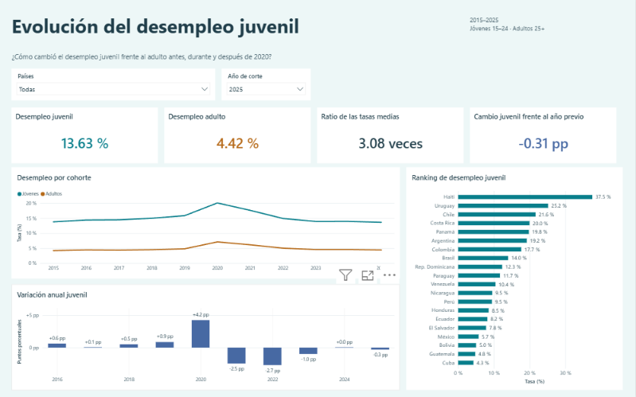
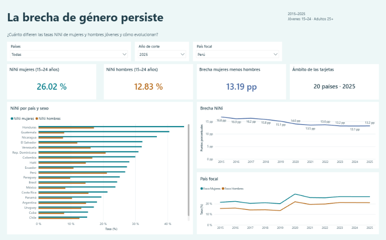
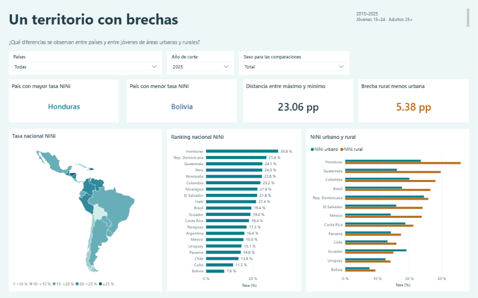
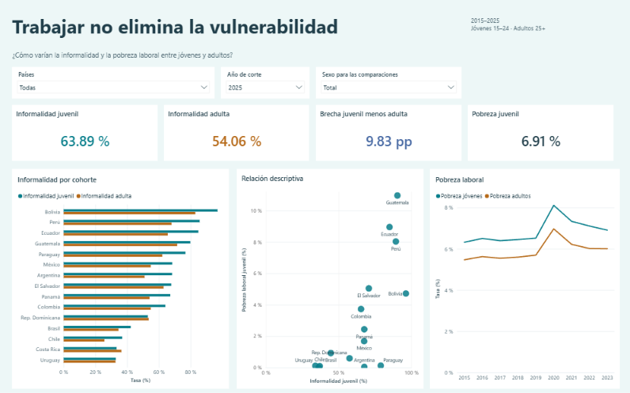

# The Waiting Generation: Visual Analysis of Youth Unemployment, Gender and Territorial NEET Exclusion, Informality, and Working Poverty in Latin America

[](https://www.python.org/downloads/)
[](https://ilostat.ilo.org/data/)
[-1B7F5C.svg)](https://www.iieta.org/Journals/IJSDP)
[](powerbi/Dashboard_V2.pbix)
[](LICENSE)

---

## Research Overview

This repository hosts the complete, reproducible data pipeline, validation notebooks, data dictionary, Power BI visual analytics project, and final bilingual scientific manuscripts (Spanish and English) for the study:

> **Title (EN):** *The Waiting Generation: Visual Analysis of Youth Unemployment, Gender and Territorial NEET Exclusion, Informality, and Working Poverty in Latin America*  
> **Título (ES):** *La generación que espera: análisis visual del desempleo juvenil, la exclusión NEET por género y territorio, la informalidad y la pobreza laboral en América Latina*  
> **Institution:** Faculty of Engineering, Universidad San Ignacio de Loyola (USIL), Lima, Peru  
> **Course:** Data Visualization (*Visualización de Datos*), 2026-02  
> **Authors:** Juan Antonio Coronado Palacios\*, Lucero Milagros Cubas Quispe, Carlos Martin Quispe Bartolo, Maria Sofia Solari Hipólito  
> **Academic Supervision:** Dr. Alfredo Daza Vergaray (`alfredo.daza@usil.pe` | ORCID: [0000-0002-2259-1070](https://orcid.org/0000-0002-2259-1070))  
> **Target Journal:** *International Journal of Sustainable Development and Planning (IJSDP)* — IIETA | ISSN: `1743-7601` / e-ISSN: `1743-761X` | **Scopus Q3** (SJR 2025: `0.312`, *Geography, Planning and Development* — [SCImago Profile](https://www.scimagojr.com/journalsearch.php?q=5200153101&tip=sid))

Starting from official ILOSTAT records (`23,891` master rows covering `2010–2026`), the analytical model strictly delimits **20 sovereign Latin American countries** (excluding the regional aggregate `X21`) over the **2015–2025** period (**15,305 validated observations**), preserving missing survey values without artificial imputation and unifying **four complementary dashboards** inside a single Power BI report (`powerbi/Dashboard_V2.pbix`).

---

## Repository Architecture

```text
youth-unemployment-latam-dataviz/
├── data/
│   ├── raw/                                          # 9 official raw CSV datasets extracted from ILOSTAT
│   └── processed/                                    # Immutable master Tidy Data outputs (untouched by audit)
│       ├── ilostat_latam_2010_2026_master_long.csv   # 23,891 rows (15,305 in 2015–2025 analytical subset)
│       └── ilostat_latam_2010_2026_master_wide.csv   # 7,518 pivoted control rows
├── notebooks/                                        # Separated by Single Responsibility Principle (SOLID)
│   ├── 01_ETL_Limpieza_Unificacion_y_EDA.ipynb       # ETL pipeline: data/raw/ -> data/processed/ + profiling
│   └── 02_Auditoria_y_Validacion_2015_2025_DAX.ipynb # Read-only audit: 14 automated CSV vs. DAX checks (error = 0.00)
├── powerbi/
│   ├── Dashboard_V2.pbix                             # Integrated 4-page Power BI report (12 charts, 16 KPIs, TopoJSON)
│   └── figures/                                      # High-resolution exports of the 4 official dashboard pages
│       ├── Figura1_01_Desempleo.png
│       ├── Figura2_02_Genero_NiNi.png
│       ├── Figura3_03_Territorio.png
│       └── Figura4_04_Vulnerabilidad.png
├── docs/                                             # Final bilingual manuscripts, dictionary, and rubric annexes
│   ├── 01_Articulo_ES_Grupo01.docx                   # Final manuscript (Spanish, strict IJSDP template)
│   ├── 02_Articulo_EN_Grupo01.docx                   # Final manuscript (English, 1:1 IJSDP mirror)
│   ├── 03_Anexo_Tecnico_Grupo01.docx                 # Mandatory 12-item methodological & technical annex
│   ├── 06_Matriz_Correcciones_Grupo01.docx           # Annex A: Observation traceability matrix
│   ├── 07_Ficha_Revista_Grupo01.pdf                  # Annex C: Scopus Q3 editorial verification sheet
│   ├── 08_Matriz_Problema_Dashboards_Grupo01.docx    # Annex B: Integrated problem-to-dashboard matrix
│   └── diccionario_de_datos.xlsx                     # Multi-sheet variable & DAX dictionary
└── README.md
```

---

## Integrative Traceability Matrix & Verified Findings (2015–2025)

All summary rates below are **unweighted arithmetic means** across eligible Latin American countries with complete records (excluding `X21`), verified with **0.00 pp discrepancy** in [`notebooks/02_Auditoria_y_Validacion_2015_2025_DAX.ipynb`](notebooks/02_Auditoria_y_Validacion_2015_2025_DAX.ipynb):

| # | Dimension | ILOSTAT Series | PBIX Page | Verified Quantitative Findings (Cutoff 2025 / Effective 2023) |
| :-: | :--- | :--- | :--- | :--- |
| **P1** | **Youth vs. Adult Unemployment** | `UR_Modelled` (`UNE_2EAP_SEX_AGE_RT`) | `01 Desempleo` | Mean youth unemployment jumped from **15.84%** (2019) to **20.08%** (2020; **+4.24 pp**) and fell to **13.63%** in 2025 vs. **4.42%** for adults (n=20), preserving a **3.08×** generational disadvantage. |
| **P2** | **Gender Disparities in NEET** | `NEET_Youth_Modelled` (`EIP_2EET_SEX_RT`) | `02 Género NiNi` | In 2025 (n=20), mean female NEET (**26.02%**) more than doubled male NEET (**12.83%**), yielding a **13.19 pp** gender gap (vs. 16.77 pp in 2015). Focal country Peru: **26.85% F** vs. **21.16% M** (**5.69 pp**); maximum gap in Guatemala (**32.58 pp**). |
| **P3** | **Territorial & Urban–Rural NEET** | `NEET_Youth_Modelled` & `NEET_Urban_Rural` (`EIP_NEET_SEX_GEO_RT`) | `03 Territorio` | In 2025 (n=20), national NEET spanned **23.06 pp** between Honduras (**30.81%**) and Bolivia (**7.75%**; Peru **23.97%**). Across 13 complete urban–rural survey pairs, rural NEET exceeded urban in 12 countries (exception: Ecuador), with a mean **+5.38 pp** rural penalty. |
| **P4** | **Informality & Working Poverty** | `Informality_National` (`EMP_NIFL_SEX_AGE_RT`) & `Working_Poverty_Modelled` (`SDG_0111_SEX_AGE_RT`) | `04 Vulnerabilidad` | Across 15 age-cohort pairs in 2025, youth informality averaged **63.89%** vs. **54.06%** among adults (**+9.83 pp**; Peru **85.68%** vs. **67.95%**). In effective year 2023 (n=19), youth working poverty averaged **6.91%** (Peru **8.04%**) and associated positively with youth informality (n=15 pairs; Peru **89.36%** / **8.04%**). |

---

## Visual Overview of the Four Integrated Dashboards (`Dashboard_V2.pbix`)

| Dashboard 1: `01 Desempleo` | Dashboard 2: `02 Género NiNi` |
| :---: | :---: |
|  |  |
| **Dashboard 3: `03 Territorio`** | **Dashboard 4: `04 Vulnerabilidad`** |
|  |  |

---

## Reproducibility & Execution

```bash
# 1. Clone the repository
git clone https://github.com/tripalidex/youth-unemployment-latam-dataviz.git
cd youth-unemployment-latam-dataviz

# 2. (Optional) Re-run the ETL pipeline from data/raw/ -> data/processed/
uv run --with jupyter --with pandas --with openpyxl jupyter notebook notebooks/01_ETL_Limpieza_Unificacion_y_EDA.ipynb

# 3. Run the read-only 2015–2025 audit notebook verifying all 14 CSV vs. DAX controls
uv run --with jupyter --with pandas jupyter notebook notebooks/02_Auditoria_y_Validacion_2015_2025_DAX.ipynb
```

To inspect the interactive dashboards, open [`powerbi/Dashboard_V2.pbix`](powerbi/Dashboard_V2.pbix) in **Microsoft Power BI Desktop**.

---

## Citation & License

```bibtex
@article{coronado2026waiting,
  title={The Waiting Generation: Visual Analysis of Youth Unemployment, Gender and Territorial NEET Exclusion, Informality, and Working Poverty in Latin America},
  author={Coronado Palacios, Juan Antonio and Cubas Quispe, Lucero Milagros and Quispe Bartolo, Carlos Martin and Solari Hip{'o}lito, Maria Sofia},
  journal={International Journal of Sustainable Development and Planning (Prepared for Submission)},
  year={2026},
  publisher={IIETA}
}
```

Code and analytical artifacts are distributed under the MIT License. Underlying labour statistics are open public records sourced from [ILOSTAT (ILO)](https://ilostat.ilo.org/data/).
